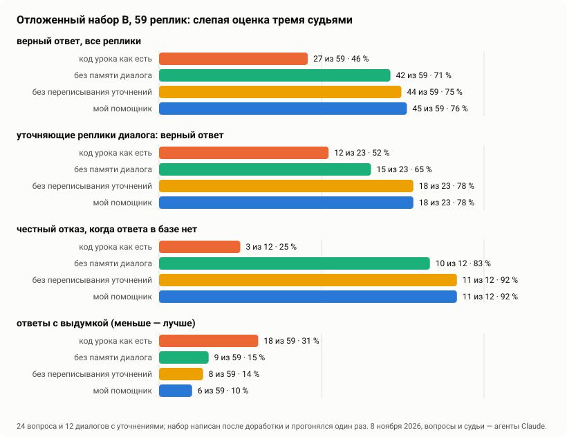

# FAQ-ассистент на сайте ai.optimum-ltd.com

Чат-помощник на сайте Александра, промпт-инженера, который делает помощников на нейросети для агентств недвижимости.
Кнопка в правом нижнем углу любой страницы **https://ai.optimum-ltd.com**: помощник отвечает на вопросы об услугах,
кейсах и порядке работы только по базе знаний сайта, помнит последние реплики разговора и честно говорит, если ответа
в материалах нет.

Сделан по уроку «Портфолио: FAQ-ассистент» на основе кода урока
[MrGAN12009/pcef9](https://github.com/MrGAN12009/pcef9): FastAPI, FAISS, эмбеддинги и ответ OpenAI. Код урока памяти
диалога не имел, поэтому её пришлось добавить, а заодно поправить поиск, промпт и безопасность. Что именно изменилось,
показано в таблице ниже.

## Результаты

Слепая оценка на отложенном наборе B: 59 реплик (24 вопроса и 12 диалогов с уточнениями). Набор написан после
доработки и прогонялся один раз; база знаний и модель ответа (gpt-4.1-mini) у всех вариантов одни и те же; судьи —
три агента Claude. Тестовые данные 8 ноября 2026 года; живых посетителей у чата пока почти нет.



| набор B, 59 реплик | код урока как есть | мой помощник |
|---|---|---|
| верный ответ | 27 (46 %) | **45 (76 %)** |
| из них на вопросы, ответ на которые есть в базе (47) | 24 | **34** |
| честный отказ, когда ответа в базе нет (12) | 3 | **11** |
| уточняющие реплики диалога: верный ответ (23) | 12 | **18** |
| неверный ответ | 10 | **3** |
| ответов с выдумкой | 18 | **6** |
| время ответа, медиана / 90-й процентиль | **1,05 / 1,31 с** | 1,67 / 2,19 с |
| токенов промпта, медиана | **477** | 1139 |

Что из этого следует:

- **Выдумки — главная беда кода урока.** Его промпт отсылает посетителя «в поддержку», которой у бренда нет, а когда
  ответа в контексте нет, он отвечает от себя: честно отказал в 3 случаях из 12. Здесь правила промпта, поиск по
  разделам и порог близости дают 11 честных отказов из 12 и втрое меньше выдумок.
- **Память диалога решает уточнения.** Тот же помощник без памяти: 42 верных ответа, на уточнениях 15 из 23;
  с памятью — 18 из 23, и все 23 уточнения он понимает правильно.
- **Переписывание уточнений на наборе B почти ничего не добавило:** без него 44 верных ответа и 8 выдумок, с ним
  45 и 6 — это в пределах разброса. На наборе A оно исправило конкретные ошибки («а второй?», «и площадь он всегда
  сам находит?»), но стоит лишнего вызова модели: медиана ответа 1,67 с вместо 1,28 с. Отключается
  `REWRITE_FOLLOWUPS=0`.
- **Где помощник ещё ошибается** (все 14 неидеальных ответов с пояснениями судей — в `eval/runs/b/report.json`):
  домысливает причины, которых нет в базе (почему черновик появлялся то за 13 минут, то за 2), приписывает
  Александру услугу «анализ рынка», путает журнал Telegram-бота с журналом этого чата, не всегда говорит, что чат
  не передаёт сообщения Александру. Это список того, что дописать в базу знаний и правила.
- **Цена.** Промпт в 2,4 раза длиннее (6 фрагментов, история и правила), ответ в медиане на 0,6 с дольше.

## Чем отличается от кода урока

| | код урока | здесь |
|---|---|---|
| память диалога | нет: каждая реплика сама по себе | 3 последние пары «вопрос — ответ» на разговор, 30 минут, кнопка «Новый диалог» |
| уточнения в диалоге | — | поиск идёт по самому вопросу, по нему вместе с прошлым вопросом и с началом прошлого ответа, и по уточнению, переписанному моделью в самостоятельный вопрос («а второй?» → «расскажите о втором кейсе…»); отвечает модель на вопрос как есть |
| документы | файл `.txt` целиком — один вектор | разделы `## …` отдельно, длинный раздел ищется ещё и по абзацам, а модели отдаётся целиком |
| поиск | `IndexFlatL2`, 3 ближайших, без порога | косинусная близость (`IndexFlatIP`), 6 разных фрагментов, порог 0,30 |
| эмбеддинги | text-embedding-3-small | text-embedding-3-large (сравнение — `eval/retrieval.py`) |
| метаданные | `.npy` с pickle (`allow_pickle=True` выполняет код из подменённого файла) | JSON |
| промпт | «отвечай по контексту, если нет — предложи поддержку» | правила: только факты из фрагментов, без цен и сроков числами, без обещаний, вопрос в тегах `<вопрос>` как данные, отказ от «передай Александру» |
| контакты посетителя | уходят в OpenAI как есть | телефоны, почта, ники, номера документов и имя после «меня зовут» вырезаются до поиска и до OpenAI; публичные контакты из базы остаются |
| журнал | нет | SQLite: вопрос и ответ без контактов, статус, найденные фрагменты, время этапов, токены, версия базы; 90 дней |
| лимиты | нет | 8 сообщений в минуту и 80 в сутки на посетителя, 1500 в сутки на всех, сообщение до 1000 знаков; отпечаток адреса для лимита живёт в памяти не дольше суток |
| время ответа | без ограничений | вызов модели до 20 с с одним повтором, переписывание уточнения до 8 с без повторов; ответ позже 50 с не сохраняется в память (сайт ждёт 60 с) |
| CORS | `allow_origins=["*"]` вместе с cookies | закрыт; виджет ходит на `/api/chat` самого сайта, сайт пересылает вопрос сюда на 127.0.0.1 |
| ошибки | текст исключения уходит посетителю | посетитель видит «напишите в Telegram», подробности — в журнале службы |
| виджет | `textContent`, адрес `localhost:8000` | без `innerHTML` и встроенных скриптов (подходит под строгий CSP), ссылки и контакты кликабельны, переписка живёт во вкладке |

## Как устроено

```
посетитель → виджет (frontend/widget.js) → POST /api/chat сайта (Flask, CSRF, отпечаток адреса)
          → POST /chat этого сервера (FastAPI, 127.0.0.1:8301)
             лимит → обезличивание → память диалога → переписывание уточнения
             → поиск FAISS (вопрос; он же с прошлым вопросом и с началом прошлого ответа; переписанный вопрос)
             → промпт с фрагментами и историей
             → gpt-4.1-mini → ответ → память → журнал SQLite
```

| путь | что внутри |
|---|---|
| `backend/app.py` | FastAPI: `/chat`, `/reset`, `/health`, лимиты |
| `backend/assistant.py` | ответ на вопрос: промпт, переписывание уточнений, поиск, вызов модели, журнал |
| `backend/rag_index.py` | загрузка FAQ и документов, векторы по разделам и абзацам, FAISS, поиск |
| `backend/build_index.py` | сборка индекса: `python -m backend.build_index` |
| `backend/memory.py` | память диалогов в процессе: последние пары, срок жизни, вытеснение старых |
| `backend/journal.py`, `backend/cleanup.py` | журнал вопросов и удаление записей старше 90 дней |
| `backend/privacy.py` | вычистка контактов, обезличенный код разговора |
| `backend/config.py` | все настройки из переменных окружения, значения по умолчанию с объяснением |
| `data/docs/*.md` | база знаний: тексты сайта, собственные проекты, как устроен сам помощник |
| `data/faqs.json` | 30 частых вопросов (поля `question` и `answer`, как в уроке) |
| `data/index/` | готовый индекс (собирается скриптом, хранится в репозитории, чтобы сервер не пересчитывал эмбеддинги) |
| `frontend/` | виджет (`widget.js`, `widget.css`) и демо-страница `index.html` |
| `deploy/` | службы systemd, таймер чистки журнала, скрипт выкладки |
| `eval/` | наборы вопросов, прогоны, слепые судьи, отчёты |
| `tests/` | тесты на подменах без сети |

## Запуск локально

Нужны Python 3.12+ и [uv](https://docs.astral.sh/uv/). Виртуальное окружение создаётся командой и в репозиторий
не кладётся (урок сам советует убрать `venv` из git: окружение с Windows на Linux не работает).

```bash
uv venv .venv
uv pip install --python .venv -r requirements.txt
cp .env.example .env                      # вписать OPENAI_API_KEY и USER_HASH_SALT
uv run --python .venv python -m backend.build_index
uv run --python .venv uvicorn backend.app:app --host 127.0.0.1 --port 8301
```

Демо-страница с виджетом: в `.env` оставить `ALLOWED_ORIGINS=http://127.0.0.1:8080`, затем
`python -m http.server 8080 --directory frontend` и открыть http://127.0.0.1:8080.

Проверка без сети и ключа: `bash check.sh` (basedpyright, затем 30 тестов: память и её сброс во время ответа,
поиск по разделам и абзацам, переписывание уточнений и его сбой, поздний ответ не попадает в память, вычистка
контактов (телефоны с точками, латинские имена, теги внутри номера) и публичные контакты из базы, теги в вопросе
в любом регистре, лимиты и то, что поток отказов не раздувает журнал, фоновая чистка отпечатков и диалогов, ошибки
API без подробностей, закрытый CORS, журнал и его миграция, чистка старых записей, индекс собран из нынешних данных
и той же моделью эмбеддингов).

## Выкладка

Помощник работает в том же контейнере, что и сайт (LXC 171 на домашнем сервере), служба `faq-assistant`
(uvicorn, один процесс: память и лимиты живут в нём), слушает только 127.0.0.1:8301. Снаружи его видно только через
`/api/chat` сайта: тот проверяет CSRF-токен, ограничивает размер запроса и передаёт солёный отпечаток адреса
посетителя в `X-Client-Key` (сам адрес помощник не получает).

```bash
bash deploy/deploy.sh --secrets path/to/.env   # первый раз: берёт из файла только строку OPENAI_API_KEY=
bash deploy/deploy.sh                          # обновления
```

Скрипт собирает архив, сверяет контрольную сумму в контейнере, ставит зависимости, **прогоняет тесты на сервере** и
только потом перезапускает службу; ключ идёт потоком прямо в `/etc/faq-assistant.env` (640, root:faq) и в выводе не
печатается. Журнал — `/var/lib/faq-assistant/journal.db`, чистка — таймер `faq-assistant-cleanup` в 03:40.
Код сайта со стороны чата (прокси `/api/chat`, виджет в шаблоне, раздел о данных) — в репозитории сайта.

## Оценка

Как считали:

- **Вопросы.** Два набора вопросов и диалогов с уточнениями писали отдельные агенты Claude, которые видели только
  тексты `data/docs` (не FAQ, не промпт и не код). В каждом наборе есть вопросы, ответа на которые в материалах нет,
  провокации, опечатки, контакты посетителя в тексте. Набор A (`eval/test_set_a.json`, 32 вопроса и 10 диалогов,
  60 реплик) служил для поиска ошибок: по нему помощник дорабатывался. Набор B (`eval/test_set_b.json`, 24 вопроса
  и 12 диалогов, 59 реплик) написан после доработки и прогонялся один раз.
- **Системы.** Код урока как есть на той же базе знаний (`eval/run_eval.py lesson`: его `build_index.py` и `app.py`,
  реплики диалога уходят по одной, как их шлёт его страница), мой помощник и он же без памяти и без переписывания
  уточнений, чтобы видеть вклад каждой части. Модель ответа у всех gpt-4.1-mini, temperature 0.2.
- **Судьи.** Три агента Claude вслепую: ответы систем под буквами, у каждого судьи свой порядок на каждом вопросе
  (`eval/judge.py`, инструкция `eval/judge_prompt.md`). Итог по ответу — медиана оценок и большинство голосов.
- **Автоматически:** числа не из базы и не из вопроса, Markdown, повтор контактов посетителя, время, токены.

### Набор B: итог (`eval/runs/b`)

| набор B, 59 реплик | код урока | без памяти | без переписывания уточнений | мой помощник |
|---|---|---|---|---|
| верный ответ | 27 | 42 | 44 | 45 |
| из них на вопросы, ответ на которые есть в базе (47) | 24 | 32 | 33 | 34 |
| честный отказ, когда ответа в базе нет (12) | 3 | 10 | 11 | 11 |
| уточняющие реплики диалога: верный ответ (23) | 12 | 15 | 18 | 18 |
| уточняющие реплики: понял, о чём речь (23) | 20 | 21 | 23 | 23 |
| неверный ответ | 10 | 6 | 5 | 3 |
| ответов с выдумкой | 18 | 9 | 8 | 6 |
| ответов с числом не из базы и не из вопроса | 2 | 1 | 1 | 1 |
| повторил телефон или почту посетителя | 0 | 0 | 0 | 0 |
| время ответа, медиана / 90-й процентиль, с | 1,05 / 1,31 | 1,23 / 1,46 | 1,28 / 1,63 | 1,67 / 2,19 |
| токенов промпта, медиана | 477 | 1005 | 1100 | 1139 |

### Набор A: поиск ошибок и доработка

Первая версия (text-embedding-3-small, 4 фрагмента, поиск только по целым разделам, без переписывания уточнений)
отвечала верно на 52 реплики из 60. Почти все ошибки были одного вида: помощник честно говорил «в материалах этого
нет», хотя ответ в базе был, — поиск ставил нужный раздел на 5–35-е место (`eval/retrieval.py`). На «Что за бот
@ZCoderTest_bot?» он отвечал, что не знает такого бота: обезличивание вырезало из вопроса ник, хотя это публичный
контакт из базы. После доработки (поиск по абзацам, text-embedding-3-large, 6 фрагментов, переписывание уточнений
и поиск по прошлому ответу, публичные контакты из базы не вырезаются, правило «не обещать, чего нет в материалах»)
— 57 из 60. Этот набор помощник уже «видел», поэтому цифры второй версии здесь завышены; честный итог — набор B.
Все четыре столбца оценены одними и теми же судьями в одних пакетах (`eval/runs/a-v2`); первая оценка версии 1
отдельно (`eval/runs/a-v1`, другие пакеты и порядок ответов) дала почти то же: версия 1 — 52, без памяти — 49,
код урока — 36.

| набор A, 60 реплик | код урока | версия 1 без памяти | версия 1 | версия 2 |
|---|---|---|---|---|
| верный ответ | 37 | 50 | 52 | 57 |
| из них на вопросы, ответ на которые есть в базе (51) | 35 | 41 | 44 | 48 |
| честный отказ, когда ответа в базе нет (9) | 2 | 9 | 8 | 9 |
| уточняющие реплики диалога: верный ответ (18) | 9 | 12 | 14 | 16 |
| неверный ответ | 10 | 7 | 5 | 0 |
| ответов с выдумкой | 17 | 1 | 1 | 1 |
| время ответа, медиана, с | 1,17 | 1,10 | 1,15 | 1,29 |
| токенов промпта, медиана | 460 | 723 | 799 | 1110 |

## Ограничения

- Память диалогов — в процессе службы: после перезапуска разговоры начинаются заново, и служба работает в один процесс.
- Обезличивание по правилам: имя без подсказки («Иван Петров, перезвоните») не распознаётся; это покрывает срок
  хранения журнала.
- Судьи и авторы тестовых вопросов — агенты Claude: одно семейство моделей, по одному прогону на вопрос.
- Один прогон на реплику при temperature 0.2: разница между вариантами помощника в 1–3 ответа из 59 — в пределах
  разброса; разница с кодом урока (18 ответов) — нет.
- Живых посетителей у чата пока почти нет, поэтому бизнес-метрик (сколько вопросов снято с Александра, сколько
  заявок пришло из чата) здесь нет — их покажет журнал, когда появится трафик.
